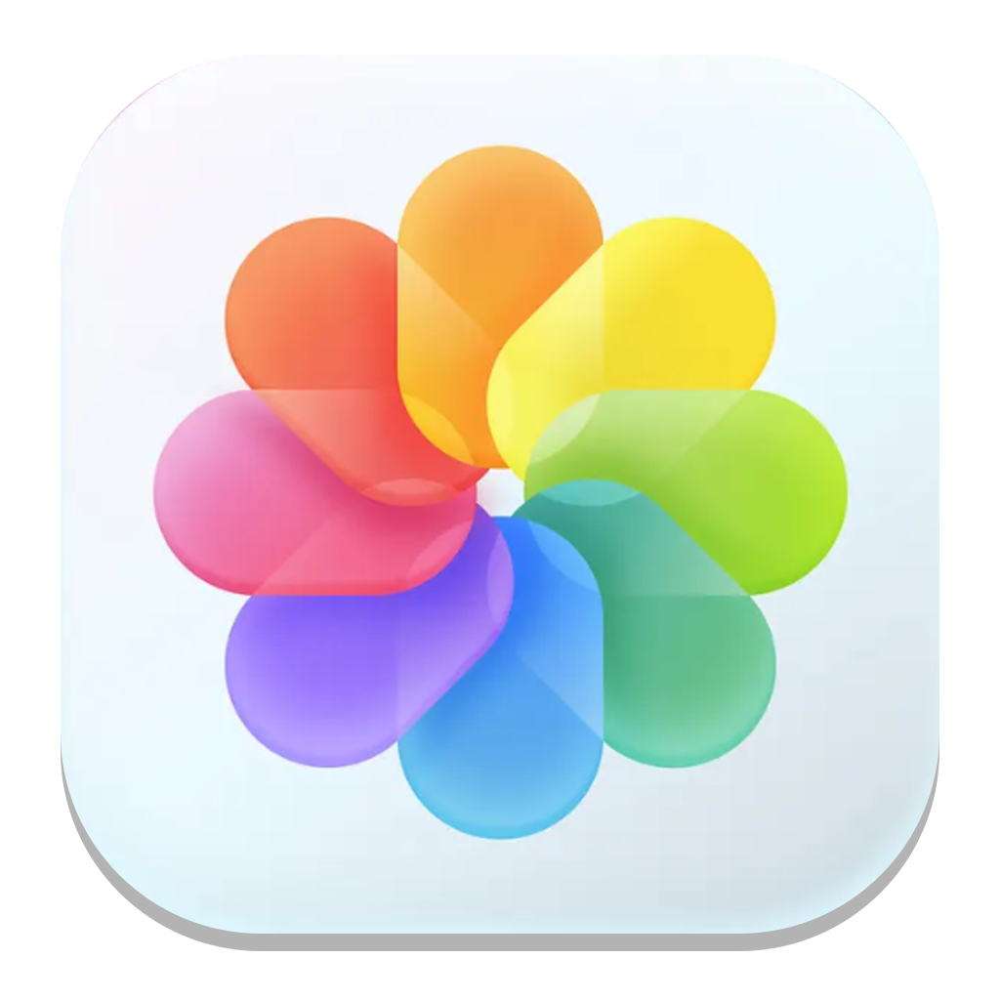

<p align="center">
  
</p>

<h1 align="center">Photos</h1>

<p align="center">
  A native library for the pictures you already have.<br>
  Windows, macOS, and Linux. Your files stay where they are.
</p>

<p align="center">
  <a href="https://github.com/SatyaKesavaKorlapati/Photos/releases/latest"></a>
  <a href="https://github.com/SatyaKesavaKorlapati/Photos/releases/latest"></a>
  <a href="https://github.com/SatyaKesavaKorlapati/Photos/releases/latest"></a>
</p>

<p align="center">
  <a href="https://github.com/SatyaKesavaKorlapati/Photos/releases/latest">Get the latest release</a>
</p>

---

Photos is a desktop gallery in the spirit of Apple Photos. Point it at a folder, including a copy of an iPhone camera roll, and it builds a fast library beside those files. It never rewrites, moves, or deletes an original.

## Download

Installers are attached to each [release](https://github.com/SatyaKesavaKorlapati/Photos/releases/latest).

| Platform | What to run | Notes |
| --- | --- | --- |
| Windows | `Photos-Setup-0.1.0.exe` | Installer. Start menu shortcut, desktop shortcut, and file associations. |
| Windows | `Photos-0.1.0-portable.exe` | No install. Run the file. |
| macOS | `Photos-0.1.0.dmg` | Open the disk image and drag Photos to Applications. Unsigned builds need a right-click → Open the first time. |
| Linux | `Photos-0.1.0-x64.AppImage` | `chmod +x` and run. A `.deb` is published for Debian and Ubuntu. |

macOS and Linux packages are built by the release workflow and show up on that same page when the build finishes. The Windows installer is attached with the release.

## What it does

**Library.** Years, months, days, and all photos. Albums, folders, favourites, hidden, and recently deleted. Search by date, camera, file name, or words like portrait, live, and selfie.

**iPhone rolls.** Live Photos stay paired with their video. Portrait shots keep their depth. Edits from the phone are read, not baked back into the file.

**Viewer.** A full-window viewer, slideshows, info, and a share sheet. On Windows that includes the system share sheet, Blip, and WhatsApp.

**Edit.** Crop, adjustments, and a portrait slider that locks onto the subject instead of the background. Exports are new files. Revert throws the edit away and leaves the original alone.

**Glass.** Liquid glass on the toolbar, popups, sidebar, and settings, each with its own intensity. The sidebar can stay fixed, or slide in from the left edge of the window.

## Privacy

- Originals are never modified.
- Import can reference files in place, or copy them byte for byte into the library.
- Deleting from the library does not delete the file on disk.
- Nothing in this repository is a photograph from a personal library.

## Build it yourself

Node.js 22 or newer.

```bash
npm ci
npm run fetch:ffmpeg   # Windows. On macOS, install ffmpeg with Homebrew.
npm run dev
```

Installers:

```bash
npm run dist:win
npm run dist:mac
npm run dist:linux
```

Output lands in `release/`.

## Releases

Pushing a version tag builds all three platforms and attaches the installers.

```bash
git tag v0.1.0
git push origin v0.1.0
```

## License

Copyright © 2026 SatyaKesava. All rights reserved.
